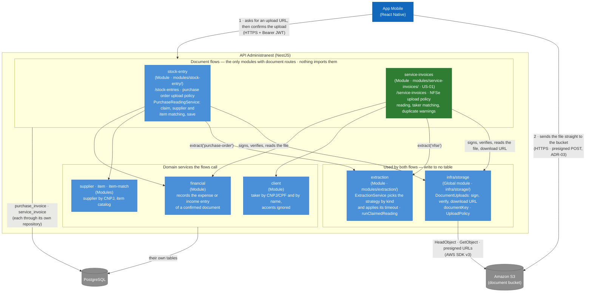

## C4 Level 3 — Components of the uploaded documents

We open the "API Administranest" box again, this time for the two flows that take a file from the app: the purchase order (`stock-entry`, US10) and the service invoice (`service-invoices`, US-01). The decisions behind this shape are in [ADR-14](../ADRs/ADR-14-document-modules.md).

> `service-invoices` is the target of US-01 and does not exist in the code yet.
> Everything else in the diagram does.

**How to read this diagram.** Arrows point from the module that imports to the module it calls. The green box is the module US-01 adds; the blue ones exist already. The three layers are the point: the flows on top hold the routes and the rows of their documents, the middle layer is shared and writes to no table, and the domain services at the bottom never learn which document called them.

**Why the file and the reading are split from the rows.** Each module writes only to its own tables (ADR-01). So `infra/storage` answers "is the file there and is it the one that was signed for?", `extraction` answers "what does this PDF say?", and the module that owns the row decides what that means: which error code, which status, which supplier or taker.

| Component | Answers | Practical rule |
| --- | --- | --- |
| `DocumentUploads` | "Was the right file uploaded? Where can it be downloaded?" | Returns `stored`, `missing` or `mismatch`; never a domain error |
| `ExtractionService` | "What does this document say?" | One strategy per kind; a bad document is a `failed` result, never a throw |
| `runClaimedReading` | "Who reads this row, and what if it breaks?" | Only the request that claims the row reads it; a failure puts it back to `PENDING` |
| `PurchaseReadingService` and its NFSe counterpart | "What does this reading mean for my row?" | Status, matching and save stay in the module that owns the table |
